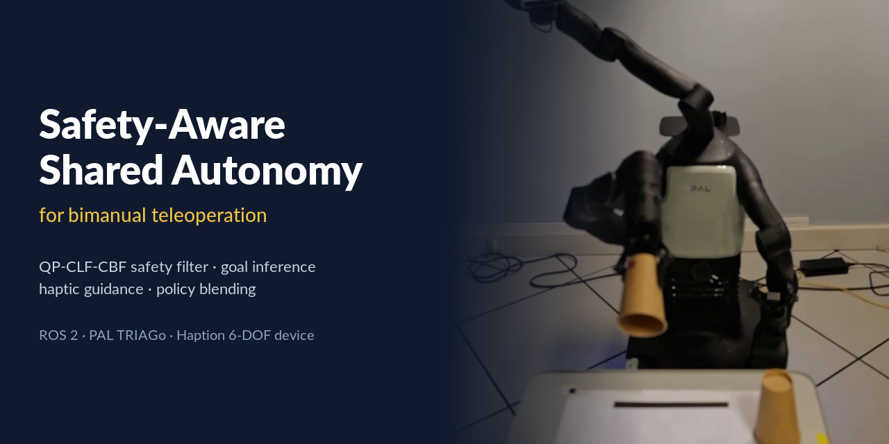
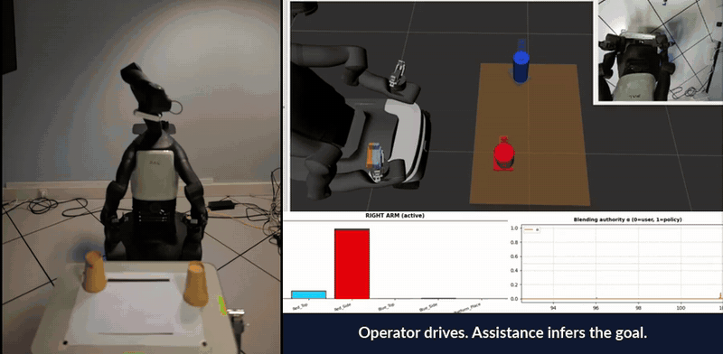
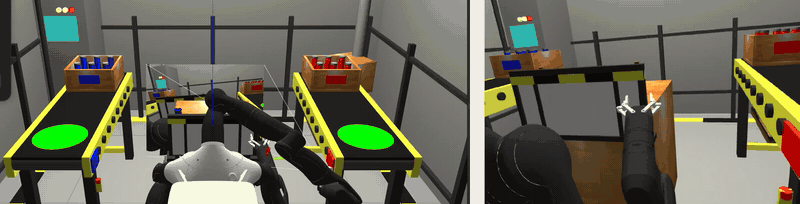
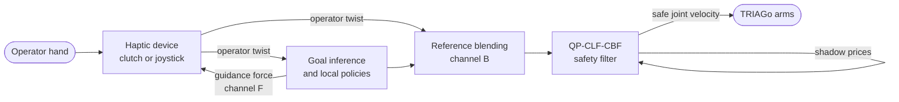
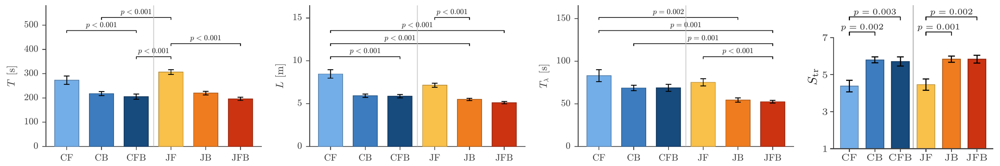

<p align="center">
  
</p>

<h1 align="center">triago_control</h1>

<p align="center">
  <b>Drive a two-armed robot through one haptic handle.</b><br>
  The robot infers your goal and helps you reach it. A safety filter checks every command before it reaches the arms.
</p>

<p align="center">
  
  
  
  
  <a href="LICENSE"></a>
</p>

<p align="center">
  <a href="#see-it-work">Demo</a> ·
  <a href="#how-it-works">How it works</a> ·
  <a href="#user-study">User study</a> ·
  <a href="#quick-start">Quick start</a> ·
  <a href="#limitations">Limitations</a> ·
  <a href="thesis/roberto_rocco_master_thesis.pdf">Thesis (PDF)</a>
</p>

---

**triago_control** is the robot side of a shared-autonomy teleoperation stack for bimanual manipulation on the PAL Robotics TRIAGo, built on ROS 2. It combines a QP-CLF-CBF safety filter (quadratic program, control Lyapunov and control barrier functions), online goal inference, reference-level policy blending, and haptic guidance. The operator-side half, with the device driver and force rendering, is [`haption_teleoperation`](https://github.com/Robertorocco/haption_teleoperation).

## See it work

<p align="center">
  
  <br><sub>Physical robot, teleoperated with force guidance and blending, about 7× speed. Left: the robot. Right: the controller's world model, the goal belief, and the assistance authority α. The first grasp attempt times out, the operator takes over and retries from above.</sub>
</p>

<p align="center">
  
  <br><sub>The simulated study environment in Gazebo, about 5× speed.</sub>
</p>

## Why this exists

A confidently wrong robot is worse than no assistance, and a robot that overrides you removes the judgement you were there to provide. So the work is split:

| The operator decides | The robot takes care of |
|---|---|
| Which object to pick | The locally best motion toward each candidate goal |
| Which side of an obstacle to pass | Collision avoidance and joint limits, at every control tick |
| When to change plan or back out | Tracking precision, and the final autonomous grasp |

Assistance is arbitrated on agreement: it grows while you move with it, and drops to zero when you move against it.

## Highlights

- **Safety filter after arbitration.** Every command, human or assisted, passes through one strictly convex QP at the joint-velocity level, with per-arm SoftMin collision barriers and joint-limit barriers.
- **Self-tuning tracking.** The QP's own KKT shadow prices tell the robot how constrained it is: tracking tightens in free space and yields near obstacles.
- **Goal inference on manifolds.** Grasps are sets of equivalent poses, not single targets, and a discounted score ranks them from the operator's twist.
- **Two assistance channels.** Force guidance on the handle (F) and reference blending (B), which can run alone or together.
- **Two teleoperation mappings.** Clutch (position control with indexing) and joystick (spring-centred rate control).
- **Hybrid grasp lifecycle.** The autonomous phase moves the target out of the collision model and back, without force sensing.
- **Runs on the real robot.** Simulation and hardware share the architecture, with a dedicated [`real-hw`](https://github.com/Robertorocco/triago_control/tree/real-hw) branch.

## How it works



The full architecture is in [`docs/REFERENCE.md`](docs/REFERENCE.md), and the mathematics is in chapter 3 of the [thesis](thesis/roberto_rocco_master_thesis.pdf).

## User study

A within-subject study with **24 participants** and **288 trials** crossed 2 mappings with 3 assistance strategies in 2 simulated scenes, one needing cooperation between the arms and one not. Each bar below is the mean over participants for one condition. C and J are the clutch and joystick mappings; F, B and FB are force guidance, blending, and both.

<p align="center">
  
</p>

| Finding | Evidence |
|---|---|
| Assistance moved task time far more than the mapping did | 306 s for JF, 196 s for JFB; no main effect of the mapping |
| Blending shortened the paths | 8.5 m for CF, 5.1 m for JFB |
| Force guidance alone was the weakest strategy | Slowest in both mappings, ranked last by 17/24 (clutch) and 21/24 (joystick) |
| Minimum clearance did not depend on the condition | 1.9 to 2.0 cm in all six |
| The safety filter had to intervene less | 83 s active in CF, 52 s in JFB |
| Participants felt more in control with blending | Control 4.54 → 5.77, trust 4.42 → 5.81, on a 7-point scale |
| Neither mapping won on preference | 13 preferred the clutch, 11 the joystick |

There was no unassisted baseline, so these results compare the strategies with one another, not with plain teleoperation.

## Quick start

You need Ubuntu 22.04, ROS 2 Humble, Pinocchio with hppfcl, `quadprog`, the PAL TRIAGo packages, and [IFRA_LinkAttacher](https://github.com/IFRA-Cranfield/IFRA_LinkAttacher) for simulated grasping. A haptic device is needed for teleoperation.

```bash
cd ~/ros2_ws/src
git clone https://github.com/Robertorocco/triago_control.git
git clone https://github.com/Robertorocco/haption_teleoperation.git
cd .. && colcon build --symlink-install && source install/setup.bash

# One terminal each
ros2 launch triago_control simulation_bringup.launch.py world:=rack_world
ros2 run triago_control main_qp_controller.py --ros-args -p world_name:=rack_world
ros2 run triago_control main_shared_autonomy.py --ros-args -p world_name:=rack_world -p plot:=false
```

The teleoperation nodes, the condition selector in `config.py`, and every parameter are covered in [`docs/REFERENCE.md`](docs/REFERENCE.md).

## Limitations

- **The barrier condition is nominal.** The QP enforces it on the sampled state. It is not a certified forward-invariance result for the sampled, actuator-lagged closed loop.
- **One safety violation on hardware.** In the same trial as the clip above, after the point where the clip ends, a later left-arm grasp stalled. A timed retreat restored a suspended collision pair onto an unresolved overlap, and the operator stopped the robot. Chapter 6 of the thesis analyses the event.
- **The belief is a heuristic score,** not a probability in the statistical sense.
- **The user study ran in simulation.** The hardware runs used a larger Haption device and earlier parameters, so they support the mechanisms and do not replicate the study.
- **Nothing here was tested by ablation.** No run compares the slack schedule or the arbitration law against a simpler alternative.

## Branches

| Branch | Contents |
|---|---|
| `feature/sim-user-study`, mirrored by `main` | Study parameters, analysis tooling, and the thesis, for simulation with the Haption Desktop 6D Compact |
| `real-hw` | Code and values that ran on the physical robot with the Haption Virtuose 6D. Frozen |

Use the branch of the same name in both repositories. Raw trial data and bags are not in git.

## Citation

GitHub's **Cite this repository** button gives the reference, from [`CITATION.cff`](CITATION.cff).

## License

BSD-3-Clause, see [LICENSE](LICENSE).
